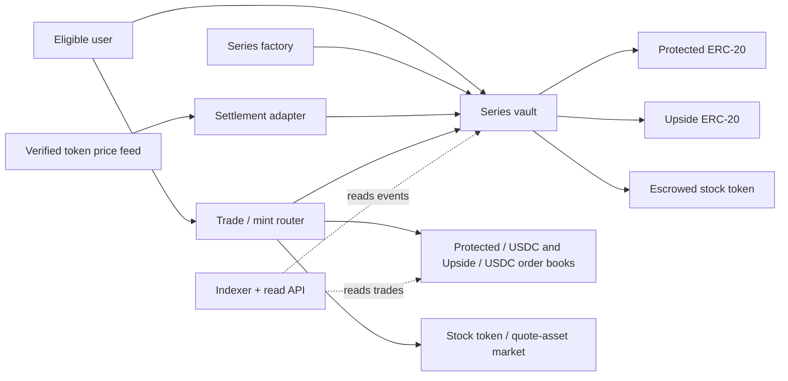
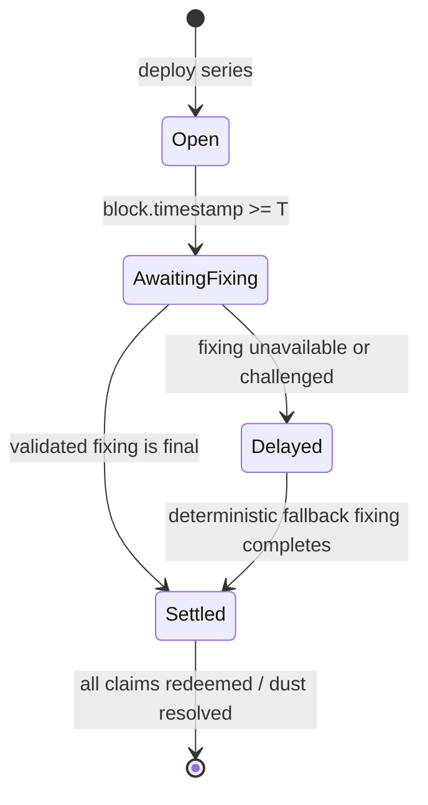

# Standalone stock risk-split protocol: technical architecture

**Architecture proposal · 30 October 2026**
[Research paper](stock-risk-split-research-paper.md) · [Interactive payoff design](stock-risk-split-design.html)

## 1. Boundary and first-version choices

This is a **separate Base protocol for one tokenized stock**, not an Othelio basket feature or a module of a user's basket Safe. It can have its own app and indexer. The only mandatory external inputs are a verified transferable stock-token address and a validated price reference for that token. A later basket-token implementation could use the same pattern but is outside this architecture.

The first version has **fixed expiry**, holds the raw stock token in its own vault, creates exactly two ERC-20 claim tokens per series, and does **not** supply collateral to Aave or borrow against it. The vault takes no directional trading positions. There is no margin account, funding rate, or liquidation engine for a holder who merely owns a fully paid claim. A holder can still lose the full market value of a claim.

The underlying token may be a Coinbase B20 token such as MSFTc, but deployment depends on verifying its actual contract, transfer policy, and oracle. A B20 multiplier changes the number of company shares represented by a raw token unit without necessarily changing its raw ERC-20 balance. Its total-return feed already includes the multiplier; the vault must **not** multiply the feed price a second time ([Base B20](https://www.base.org/blog/b20-tokenized-stocks-on-base)).

## 2. Components and trust boundaries



| Component | Onchain responsibility | Control / dependency |
| --- | --- | --- |
| `SeriesFactory` | Deploy or register a uniquely identified series and its two claim tokens; reject duplicate terms | Governance-controlled allowlist of underlying addresses, feed adapters, formula versions, and supported expiry schedules |
| `RiskSplitSeries` vault | Custody underlying; equal-pair mint/burn; track supply; settle each claim after fixing | Payoff terms immutable per series; no admin withdrawal of backing |
| `ClaimToken` × 2 | Transferable Protected and Upside ERC-20 balances; mint/burn only by their series vault | Transfer eligibility/pause policy must match the intended legal distribution |
| `SettlementAdapter` | Validate the one expiry fixing and return normalized price and source proof | Price-feed dependency; no arbitrary administrator-selected price |
| Router | Compose deposits, swaps, pair redemption, and slippage limits in one user transaction | Convenience only; it must have no custody or settlement authority |
| Order-book venue | Accept, cancel, match, and settle limit orders for each claim against USDC; expose bids, asks, depth, and fills | Matching and custody model to be selected; never an oracle for settlement |
| Indexer/read API | Expose series, balances, fixing, payoff previews, market quotes, and events | Can fail without changing onchain rights |

The factory and adapter are protocol infrastructure. They are **not** the basket factory, basket oracle, or basket portfolio module. Existing Othelio frontend/wallet components may be reused later as presentation infrastructure, but the claim rights must be enforceable without Othelio's backend.

## 3. Series identity and parameters

Define a series by a collision-resistant hash of at least:

```text
chainId | underlying token address | Protected floor F | Protected cap C
| payoff formula version | expiry timestamp T | settlement adapter address
| fixing policy version | claim transfer-policy version
```

Require `0 ≤ F ≤ C`, a future `T` in a supported fixing window, explicit underlying and feed decimals, and a **price per raw underlying token unit**. Do not identify the asset by ticker alone. Factory deployment should be atomic: initialize vault and both claim tokens in one transaction, or revert. A deployment cannot be reinitialized. Deterministic clone addresses are an optional implementation choice; OpenZeppelin's [ERC-1167 clone tooling](https://docs.openzeppelin.com/contracts/5.x/api/proxy) supports this pattern. For a first pilot, ordinary contracts are also acceptable if the reduced deployment complexity is worth the gas.

The claim tokens have one-to-one *unit* denominations with raw stock-token units at mint: depositing `d` underlying units mints `d` Protected and `d` Upside units. Each claim token can use the underlying's decimal count for display, but accounting uses exact integer raw units and checked multiplication/division.

## 4. Vault state machine and calls



**Open, before `T`:**

```solidity
deposit(uint256 requested, address recipient)
  -> (uint256 actualReceived, uint256 protectedMinted, uint256 upsideMinted)
redeemPair(uint256 amount, address recipient) -> uint256 underlyingOut
```

`deposit` transfers the underlying first, measures the vault's raw-balance delta, requires an exact supported amount, then mints the same amount of each claim. For the first version, reject fee-on-transfer or rebasing raw-balance behavior rather than silently over-issuing. `redeemPair` burns equal amounts of both claims and transfers the same raw underlying amount. The router may perform approval, deposit, and swap operations atomically, but the vault functions must remain directly callable by eligible holders.

**At or after `T`:** stop new deposits. Keep `redeemPair` available while possible, including during a fixing delay, because a complete pair always maps to one raw underlying unit without needing a price. A complete pair should remain redeemable after settlement as well; implementing this before separate burns avoids inconsistent accounting.

**After a final fixing:**

```solidity
redeemProtected(uint256 amount, address recipient) -> uint256 underlyingOut
redeemUpside(uint256 amount, address recipient) -> uint256 underlyingOut
```

Let `S` be the normalized fixed price of one raw underlying unit, and calculate

```text
P(S) = min(S, max(F, min(S / 2, C)))
U(S) = S - P(S)
eP   = P(S) / S
eU   = 1 - eP
```

For `S > 0`, redeeming `n` Protected units transfers `n × eP` raw underlying units; Upside transfers `n × eU`. At `S = 0`, use a precommitted rule, such as `eP = 1, eU = 0`, to avoid division by zero. The fixed price determines the **fraction of the token** each side receives; the vault does not promise a USD cash payment. Specify fixed-point precision, round **down** on individual transfers, and retain enough reserve for all remaining claims. Handle final dust only after the redemption window and according to an immutable rule. Prefer a rule that cannot redirect meaningful backing to an administrator.

### Required invariants

Before any individual settlement, in the no-fee design:

```text
underlying raw balance Q = Protected supply NP = Upside supply NU
```

After some individual burns, the stronger general requirement is:

```text
Q >= ceil(NP × eP + NU × eU) in raw underlying units
```

subject to the exact rounding convention. The series must reconcile its **actual** token balance on each state-changing operation, not only an internal counter. If the underlying issuer seizes or freezes assets, this invariant can fail or transfers can fail; contract code cannot promise redemption from assets no longer present.

The current research paper proves `0 ≤ P(S) ≤ S`, `0 ≤ U(S) ≤ S`, and `P(S)+U(S)=S` for every nonnegative `S`. Contract tests should prove the integer implementation preserves a conservative version of those properties for all permitted `F,C,S` and supply sizes.

## 5. Settlement adapter: the hardest oracle decision

A naive `finalize()` call that reads `latestRoundData()` whenever someone first calls after expiry gives the caller discretion over **when** the price is sampled. This is unacceptable: a caller can wait for a favorable stock move. Chainlink's [historical-feed documentation](https://docs.chain.link/data-feeds/price-feeds/historical-data) exposes `getRoundData(roundId)` and timestamps, but also warns that round IDs and proxy phases are not a simple onchain loop. The adapter needs a written, testable fixing policy **before** launch.

One workable first-version policy to evaluate is:

1. Define a regular **feed-active** UTC window and exact expiry timestamp `T` at series creation. This is a Chainlink token-price fixing, not necessarily an official stock-exchange closing auction.
2. Permit anyone to propose a feed round whose `updatedAt` lies inside `[T, T + Δ]`, whose answer is positive, and whose feed address/decimals match the immutable series parameters.
3. During a fixed challenge period, permit a challenger to submit an **earlier valid round in the same window**. The adapter keeps the earliest verifiable timestamp, with a deterministic tie-breaker.
4. After challenge, freeze `(roundId, updatedAt, normalized S)` forever. The finalizer receives no discretion to choose a price.

This is only secure if an honest watcher can find and challenge an omitted earlier round. It is **not** a fully trustless proof that the submitted round is the first feed update. For production, require either a provider-signed historical fixing at a prescribed timestamp, a verifiable round-selection proof, or an explicitly governed oracle with disclosed trust assumptions. A multi-signer emergency fallback may **delay** settlement but should not be able to pick a favorable price without a public challenge process. A missing valid fixing must leave pair redemption available and single-leg redemption paused until the defined fallback resolves.

Feed freshness must be evaluated against its published hours. Coinbase stock feeds are described as 24/5 and can hold the last value over weekends; a weekend `latestRoundData()` read is therefore not a new weekend stock fixing ([Aave's tokenized-stock market description](https://aave.com/blog/coinbase-tokenized-stocks)). Pilot expiries should occur during a known active feed window, with calendar exceptions handled in the terms rather than ad hoc by a keeper.

## 6. Trading architecture: visible limit-order books

The protocol does not set each token's market price. It supplies an onchain conversion:

```text
1 stock token <-> 1 Protected + 1 Upside
```

With executable markets and fees ignored, `price(Protected) + price(Upside) = price(stock token)`. The **sum** is anchored; the ratio is discovered by trading. Each series has two visible, USDC-quoted books: `Protected/USDC` and `Upside/USDC`. Users can post priced limit bids and asks, cancel their unfilled orders, and take resting orders. The interface shows best bid/ask, spread, depth by price level, recent fills, and the user's open orders. Partial fills must update remaining size correctly. A marketable limit order executes only at its limit price or better.

No automated-market-maker pool or LP deposit is required. Resting orders are the liquidity. A matching engine may be entirely onchain, or an offchain order relay/matcher may pair signed orders with onchain settlement. In the latter design, signed orders must remain verifiable and cancellable onchain, and the displayed book must reflect actually executable orders rather than merely unverified database rows. The exact venue and matching architecture remain an evaluation decision; [Clober V2](https://github.com/clober-dex/v2-core) is one Base reference to inspect, **not** a selected integration.

The router can compose pair mint/redeem with book executions where atomic settlement is supported. A user can also simply buy Protected or Upside with USDC by lifting an ask, or sell into a bid. Traders who already hold stock can mint both claims and offer either or both. Recombination gives arbitrageurs a route when the combined ask is sufficiently below executable stock value; minting gives a route when the combined bid is sufficiently above it. Fees, gas, token-transfer constraints, and stock-market spreads create an arbitrage band, so parity is not guaranteed tick by tick. A standalone Protected token cannot be redeemed before expiry without acquiring Upside.

Matching does not manufacture counterparties. At launch, users may post orders, but useful depth may require professional or treasury-funded market makers to place ordinary cancellable bids and asks and manage their own P, U, and USDC inventory. This is market-making capital, not an LP pool. Each new expiry and payoff series has new claim addresses and new books; makers must quote those books deliberately. Set a defined trading cutoff and cancel or expire stale orders around fixing so resting quotes cannot be unexpectedly filled after the economics change. The vault's redemption rights remain independent of the matching venue.

## 7. Offchain services and user flow

The indexer watches `SeriesCreated`, `Deposited`, `PairRedeemed`, `FixingProposed`, `FixingChallenged`, `FixingFinalized`, `ProtectedRedeemed`, and `UpsideRedeemed`, plus claim-token transfers and order placement, cancellation, and fills. Its database can reconstruct supply and balances, but the vault's onchain state remains authoritative. The API returns series terms, lifecycle state, fixed price/proof, payoff chart, both books' executable depth, and trade history. A quote service can compute indicative model values for display; **it cannot determine settlement**.

The app's primary actions are `Split stock`, `Place limit order`, `Cancel order`, `Buy Protected`, `Buy Upside`, `Combine pair`, and, after settlement, `Redeem claim`. Before signing, show the underlying address, expiry/fixing policy, floor and cap, order price/size, estimated fill and fees, whether the claim can redeem alone yet, and transfer eligibility. Indexing or book outages should disable convenience trading while leaving direct vault redemption available where the underlying permits transfers.

## 8. Security and launch gates

**Contract checks:** reentrancy protection around transfers/mint/burn; exact receiver balance checks; role limits; one-time initialization; immutable economic terms; isolated series escrow; no admin sweep of claim backing; invariant checks; conservative `mulDiv` rounding; fuzz tests across boundary prices `0,F,2F,2C`, very large values, partial redemptions, and arbitrary transfer order. Test token freeze, seize, and failed-transfer behavior using mocks. Add a formal or property-based proof that aggregate payouts never exceed actual escrow under the intended token behavior.

**Oracle checks:** prove the fixing policy against delayed submissions, out-of-order rounds, feed phase changes, stale weekend values, zero/negative answers, decimals changes, feed replacement, and no-round windows. The oracle adapter is a launch blocker until this is specified and independently reviewed.

**Market checks:** order validity, price-time priority or documented alternative, partial fills, cancellation races, replay protection, settlement atomicity, book reconstruction, executable-stock liquidity, paired-arbitrage routes, maker inventory risk, expiry cutoff, and round-trip costs. Include paused underlying transfers and stock-market gaps in simulations.

**Eligibility checks:** confirm the vault can receive/send the B20 underlying, and that derived claim transfers through the selected settlement venue comply with applicable restrictions. B20 permits transfer blocking, pauses, and seizure; supported addresses and policies must be verified for the exact token ([Base B20](https://www.base.org/blog/b20-tokenized-stocks-on-base)).

## 9. Build order

1. **Specification and mocks:** freeze integer payoff formula, decimals, oracle-fixing policy, claim-transfer policy, and all state transitions. Build a reference calculator and property tests.
2. **Core contracts:** factory, one series vault, two claim tokens, and direct pair mint/redeem. Prove escrow conservation before adding trading.
3. **Settlement:** adapter, challenge/fallback process, independent claim redemption, and oracle adversarial tests. This is the highest-risk component.
4. **Order-book prototype:** compare onchain matching with signed-order matching and onchain settlement; implement two mock claim/USDC books with limit, cancel, partial-fill, and cutoff behavior. Select a venue only after transfer compatibility and executable depth are verified.
5. **Read stack and app:** index both books, show bids/asks and own open orders, support order placement/cancellation, payoff disclosure, claim redemption, and monitoring.
6. **External review and limited pilot:** audit core contracts and oracle assumptions, verify real underlying permissions and eligibility, then launch one underlying and one expiry series.

The first implementation milestone should be a **standalone contract prototype against a mock stock token and mock feed**. No basket integration, Aave lending, personalized strikes, or no-expiry claims are needed to validate the first version.
