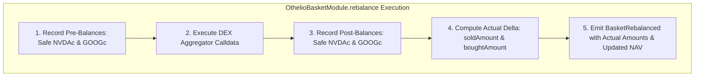
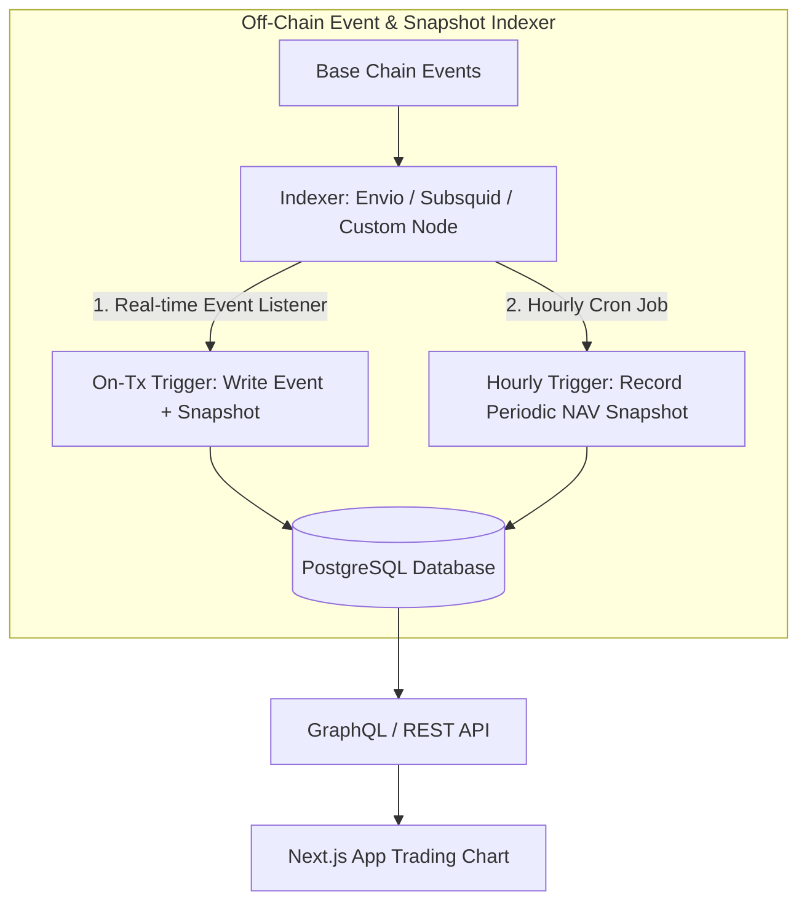
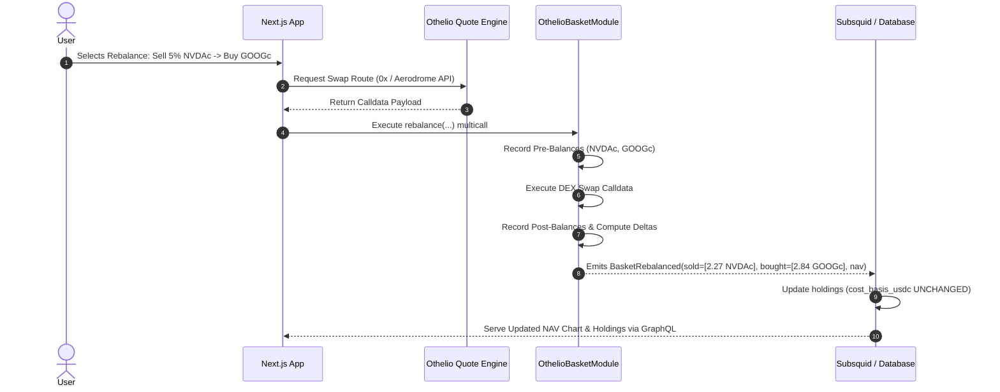

# Othelio Contracts & Backend Indexing Specification

> **Executive Summary:** This specification defines the smart contract events, atomic multicall rebalance execution mechanics, external DEX swap delta accounting (slippage & fees), oracle NAV computation, and the off-chain indexing architecture required to render accurate historical NAV charts and performance metrics.

---

## 1. Event Mechanics & External DEX Swap Accounting

When executing rebalances or funding through external DEXs (like 0x, Aerodrome, 1inch, or Uniswap), **on-chain execution encounters DEX fees, price impact, and slippage.**

### **How We Adjust for External DEX Swaps: Pre/Post-Balance Delta Measuring**

Rather than relying on quote estimates, `OthelioBasketModule` measures **exact actual balance deltas** before and after executing the external DEX swap calldata.



### **A. Concrete Example (Slippage & DEX Fee Handling):**

Suppose a user rebalances by selling $500 worth of `NVDAc` to buy `GOOGc`:

1. **Pre-Swap Measurement:**
   - Safe holds `10.0 NVDAc` and `0.0 GOOGc`.
2. **External DEX Swap Execution:**
   - `OthelioBasketModule` executes DEX calldata (e.g. 0x / Aerodrome API route).
   - DEX fee (0.3%) + 0.1% slippage reduces net proceeds from $500 to $498.
3. **Post-Swap Delta Computation:**
   - `soldAmount = preNVDA - postNVDA = 2.27 NVDAc` ($500 value)
   - `boughtAmount = postGOOG - preGOOG = 2.84 GOOGc` ($498 value)
4. **Event Emission:**
   ```solidity
   emit BasketRebalanced(
       safeAddress,
       controller,
       [NVDAcAddress], [2.27],
       [GOOGcAddress], [2.84],
       totalNAVAfter // Automatically reflects the updated $498 GOOGc value
   );
   ```

### **B. Why Pre/Post Delta Accounting is Flawless:**

| Accounting Dimension | How It Is Handled | Result |
| :--- | :--- | :--- |
| **DEX Slippage / Fees** | Captured in `postGOOG - preGOOG`. | Total NAV updates naturally to reflect post-swap balance ($498). |
| **User Capital Cost Basis** | `cost_basis_usdc` remains **unchanged**. | Small $2 swap fee is correctly logged as trading cost / performance reduction. |
| **Indexer Synchronization** | Emits **actual executed fill amounts**, not estimated quotes. | Zero desync between indexer database and real on-chain Safe holdings. |

---

## 2. Smart Contract Events Definition

The contracts emit explicit, structured events for every state change.

```solidity
// SPDX-License-Identifier: MIT
pragma solidity ^0.8.24;

interface IOthelioEvents {

    /// @notice Emitted when a new Safe basket is initialized
    event BasketCreated(
        address indexed safe,
        address indexed owner,
        string name,
        uint256 createdAt
    );

    /// @notice Emitted when capital enters the basket
    event BasketFunded(
        address indexed safe,
        address indexed funder,
        address inputAsset,          // e.g. USDC or WETH
        uint256 inputAmount,         // Amount of input asset spent
        address[] acquiredAssets,    // Constituents acquired
        uint256[] acquiredAmounts,   // Quantities deposited into Safe (measured via pre/post delta)
        uint256 totalNAVAfter        // Aggregate Basket NAV in USDC immediately after deposit
    );

    /// @notice Emitted when capital is withdrawn from the basket
    event BasketWithdrawn(
        address indexed safe,
        address indexed owner,
        address outputAsset,         // e.g. USDC or Address(0) for In-Kind
        uint256 navRedeemed,         // Total USD value of redeemed assets
        address[] withdrawnAssets,   // Constituents transferred out
        uint256[] withdrawnAmounts,  // Quantities transferred out
        uint256 remainingNAV         // Remaining Basket NAV in USDC
    );

    /// @notice Emitted when internal holdings are rebalanced via external DEX swaps (measured via pre/post delta)
    event BasketRebalanced(
        address indexed safe,
        address indexed controller,
        address[] soldAssets,        // Assets sold during rebalance (e.g. NVDAc)
        uint256[] soldAmounts,       // Actual quantities sold
        address[] boughtAssets,      // Assets bought during rebalance (e.g. GOOGc)
        uint256[] boughtAmounts,     // Actual quantities bought (after DEX fee/slippage)
        uint256 totalNAV             // Aggregate Basket NAV in USDC post-rebalance
    );

    /// @notice Emitted when an owner sweeps accidental / untracked tokens
    event UntrackedAssetSwept(
        address indexed safe,
        address indexed owner,
        address indexed token,
        uint256 amount
    );
}
```

---

## 3. NAV Computation & Corporate Action Multipliers

### **A. Aggregate NAV Formula**

At any timestamp $t$, the Net Asset Value (NAV) of a basket is computed as:

$$\text{Basket NAV}_t = \sum_{i=1}^{N} \left( \text{Raw Balance}_{i,t} \times \text{Chainlink Price}_{i,t} \times \text{Corporate Action Multiplier}_{i,t} \right) + \text{USDC Balance}_t$$

### **B. Handling Coinbase B20 Stock Splits**
- Coinbase B20 stock tokens on Base use **constant raw token balances** during stock splits; a multiplier updates on-chain.
- **Chainlink B20 Oracles natively incorporate this multiplier in their feed output.**
- **Rule:** Multiply raw balance by Chainlink price feed output directly. Do **not** apply the split multiplier a second time.

---

## 4. Off-Chain Indexing & Historical NAV Engine

### **Dual-Layer Snapshot Indexer Architecture**



### **A. Database Schema Blueprint**

#### 1. `baskets`
| Column | Type | Description |
| :--- | :--- | :--- |
| `safe_address` | `VARCHAR(42) PRIMARY KEY` | Address of the Safe Smart Account. |
| `owner_address` | `VARCHAR(42)` | Current owner wallet address. |
| `name` | `TEXT` | User-defined basket name. |
| `created_at` | `TIMESTAMP` | Deployment timestamp. |
| `cost_basis_usdc` | `NUMERIC(18, 6)` | Cumulative net USD deposited by user. |

#### 2. `basket_snapshots` (Historical Time-Series for Charts)
| Column | Type | Description |
| :--- | :--- | :--- |
| `id` | `BIGSERIAL PRIMARY KEY` | Snapshot ID. |
| `safe_address` | `VARCHAR(42) REFERENCES baskets` | Safe address. |
| `timestamp` | `TIMESTAMP NOT NULL` | Snapshot timestamp. |
| `block_number` | `BIGINT NOT NULL` | Block height. |
| `total_nav_usdc` | `NUMERIC(18, 6)` | Total NAV in USDC at snapshot. |
| `holdings_json` | `JSONB` | Breakdown of raw balances & asset prices: `{"AAPLc": {"amount": "10.5", "price": "220.50"}}` |

#### 3. `basket_transactions`
| Column | Type | Description |
| :--- | :--- | :--- |
| `tx_hash` | `VARCHAR(66) PRIMARY KEY` | Transaction hash. |
| `safe_address` | `VARCHAR(42)` | Safe address. |
| `event_type` | `VARCHAR(20)` | `FUNDED` \| `WITHDRAWN` \| `REBALANCED` \| `SWEPT` |
| `input_usdc_val` | `NUMERIC(18, 6)` | Capital in/out value. |
| `nav_after` | `NUMERIC(18, 6)` | Resulting basket NAV. |
| `timestamp` | `TIMESTAMP` | Block timestamp. |

---

## 5. Performance Accounting: Time-Weighted Return (TWR)

When a user deposits $1,000 on Day 1 and another $5,000 on Day 10, the indexer must compute **Time-Weighted Return (TWR)** so the $5,000 deposit is not shown as a fake +500% profit spike on the chart.

### **Time-Weighted Return Calculation Method:**

Between cash-flow events $k$ and $k+1$:

$$R_k = \frac{\text{NAV}_{\text{before flow } k+1} - \text{NAV}_{\text{after flow } k}}{\text{NAV}_{\text{after flow } k}}$$

$$\text{Cumulative TWR} = \left( \prod_{k=1}^{M} (1 + R_k) \right) - 1$$

* **Benefit to User:** The UI chart displays true investment strategy performance separate from net cash deposits/withdrawals.

---

## 6. End-to-End System Integration


