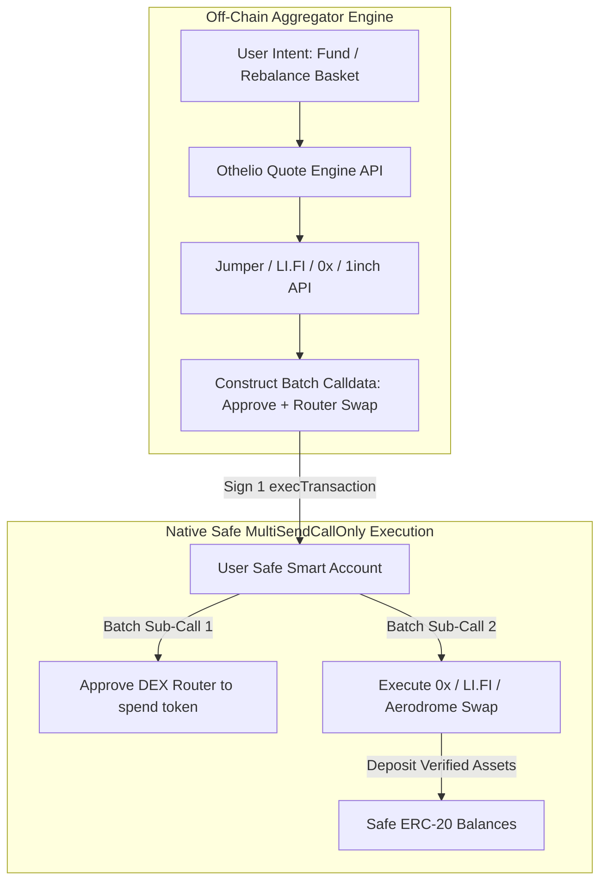
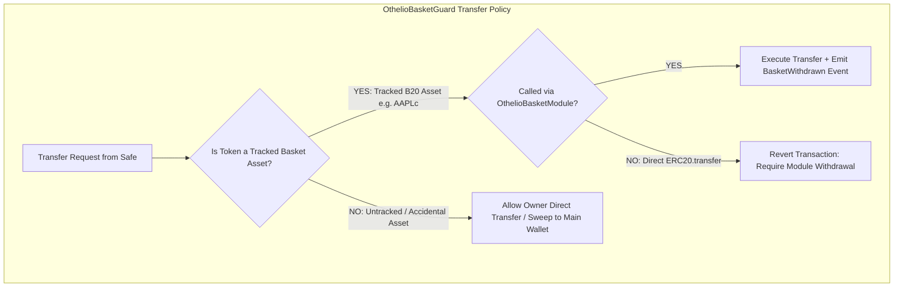

# Othelio Core Product Architecture & Implementation Plan

> **Executive Summary:** This document details the technical design, contract architecture, direct Safe Smart Account ownership model, verified asset registry, accidental transfer recovery accounting, native Safe MultiSend routing (LI.FI, Jumper, 0x, 1inch), off-chain routing aggregation, cross-chain funding, upgradeability, and V2 lending/borrowing roadmap for Othelio's personal tokenized stock baskets on Base.

---

## 1. Scope Strategy: V1 Core vs. V2 Expansion

| Feature / Capability | Release Target | Core Responsibility |
| :--- | :--- | :--- |
| **Safe Smart Account Basket Engine** | **V1 (Core Launch)** | Battle-tested non-custodial asset vault per user. |
| **Native Safe MultiSend Router Integration** | **V1 (Core Launch)** | Native 1-click batching via `MultiSendCallOnly` with LI.FI, Jumper, 0x & 1inch. |
| **`OthelioAssetRegistry.sol`** | **V1 (Core Launch)** | Allowlist of verified Coinbase B20 tokens (`AAPLc`, `NVDAc`) & `USDC`. |
| **`OthelioBasketGuard.sol`** | **V1 (Core Launch)** | Strict module-only withdrawal rule for tracked assets & anti-spam guard. |
| **Cross-Chain Bridge Funding** | **V1 (Core Launch)** | Deposit Mainnet WETH $\rightarrow$ Base Stock Basket in 1 tx payload via Jumper. |
| **In-Kind & USDC Module Withdrawals** | **V1 (Core Launch)** | Emits `BasketWithdrawn` events and reconciles cost basis. |
| **Aave Yield Supply Module (`OthelioAaveModule`)** | **V2 Module** | Automatically supply idle USDC inside Safe to Aave v3 for APY. |
| **Collateralized Borrowing Markets (Morpho Blue)** | **V2 Module** | Lock aggregate basket NAV as collateral to borrow USDC loans. |

---

## 2. Off-Chain Aggregation & Native Safe MultiSend Routing

Othelio uses off-chain route aggregation (via **Jumper / LI.FI / 0x / 1inch**) to find the lowest slippage, deepest liquidity routes for verified assets.



### **A. Why Native Safe MultiSend is Superior:**
- **Zero Custom Swap Contracts:** Uses standard canonical `MultiSendCallOnly` (`0x40A2aE261e1AC1708957d170149A2B6a4c6042cf`).
- **Production-Proven Security:** Used natively by Safe Apps, LI.FI, and CoW Swap.
- **Atomic Execution:** Approving the DEX router and executing the multi-asset swap happens in 1 single transaction block.

---

## 3. Strict Withdrawal Guard & Event Logging Rule

### **Core Rule: Tracked Basket Constituents MUST ONLY Be Withdrawn via `OthelioBasketModule`**

To prevent indexer desynchronization and ensure every withdrawal updates cost basis and emits structured protocol events (`BasketWithdrawn`), **tracked constituents cannot be transferred out via generic direct `ERC20.transfer` calls.**



### **A. How Tracked vs. Untracked Withdrawals Work**

| Asset Category | Permitted Withdrawal Method | Events Emitted | Accounting Impact |
| :--- | :--- | :--- | :--- |
| **Tracked Basket Constituents** (`AAPLc`, `NVDAc`, Basket `USDC`) | **ONLY via `OthelioBasketModule.withdraw(...)`** | Emits `BasketWithdrawn(user, assets[], amounts[], remainingNAV)` | Reconciles cost basis, logs time-weighted performance, and updates indexed portfolio NAV. |
| **Untracked / Accidental Assets** (Unlisted tokens, airdrops) | **Direct Transfer / `sweepUntrackedAsset(...)`** | Standard ERC-20 `Transfer` | Zero impact on basket cost basis or NAV. |

---

## 4. Verified Asset Registry & Anti-Spam Protection

To ensure users never deposit scam/airdropped tokens and that spam tokens never pollute basket NAV calculations or UI views, **Othelio enforces a strict On-Chain Verified Asset Registry (`OthelioAssetRegistry.sol`)**.

1. **On-Chain Allowlist (`OthelioAssetRegistry.sol`):**
   - Maintains an up-to-date registry of verified Coinbase Tokenized Stocks (B20 tokens on Base like `AAPLc`, `NVDAc`, `MSFTc`) and benchmark assets (e.g. `USDC`).
   - Stores Chainlink price feed mapping for each registered constituent.

2. **Frontend & Indexer Anti-Spam Filtering:**
   - Unregistered tokens are completely ignored, filtered from the portfolio holdings UI, and excluded from Net Asset Value (NAV) computations.

---

## 5. Direct Transfer Recovery & Accounting Invariants

What happens if a user accidentally transfers tokens directly to their Safe address without using the Othelio UI funding flow?

1. **100% Owner Recoverability for Untracked Assets:**
   - `OthelioBasketGuard` **always permits the owner to sweep untracked assets out of the Safe back to their main EOA wallet**.

2. **Cost Basis & Performance Separation:**
   - Official portfolio deposits emit `BasketFunded(user, depositAmount, acquiredConstituents)`.
   - Direct accidental transfers do **not** trigger a funding event and are **not** counted as capital contributions or trading profits.

3. **UI "Untracked Assets" Recovery Tab:**
   - The UI separates holdings into **Active Basket Allocation** vs. **Untracked / Recoverable Assets** with a 1-click **"Sweep to Wallet"** button.

---

## 6. Do We Need an NFT Position Token?

### **Decision: NO — Direct Safe Ownership**

By utilizing Safe Smart Accounts as personal baskets, **we do NOT need an ERC-721 NFT wrapper**.

- **Transferability:** Call `Safe.swapOwner(oldUser, newUser)` natively.
- **Gas Efficiency:** Zero NFT minting gas costs.
- **Native Ecosystem Support:** Discovered natively by Safe UI, WalletConnect, and EIP-4337 wallets.

---

## 7. Streamlined Smart Contract Blueprint

```
contracts/
├── registry/
│   └── OthelioAssetRegistry.sol      # Allowlist of verified Coinbase B20 tokens, USDC & Chainlink feeds
├── safe/
│   ├── OthelioBasketModule.sol       # V1 Safe Module: Handles withdrawInKind/withdrawToUSDC & emits BasketWithdrawn events
│   └── OthelioBasketGuard.sol        # V1 Safe Guard: Enforces module-only withdrawals for tracked assets & allows untracked sweeps
├── factory/
│   └── OthelioSafeFactory.sol        # V1 Helper factory to deploy Safe Proxy + attach Guard/Module in 1 tx
├── oracle/
│   └── BasketOracle.sol              # Chainlink B20 + USDC composite price feed
└── v2_modules/
    ├── OthelioAaveModule.sol         # V2 Aave yield supply module
    └── MorphoVaultAdapter.sol        # V2 Morpho Blue borrowing market integration
```

---

## 8. Actionable Implementation Roadmap

### **Phase 1: V1 Core Contracts & Safe Setup (Base Sepolia)**
- [ ] Implement `OthelioAssetRegistry.sol` with B20 allowlist functions.
- [ ] Implement `OthelioSafeFactory.sol`, `OthelioBasketModule.sol`, and `OthelioBasketGuard.sol` (with module-only withdrawal enforcement for tracked assets).
- [ ] Unit tests for Safe basket deployment, verified asset deposit, module withdrawal with `BasketWithdrawn` event emission, and direct untracked asset sweeping.

### **Phase 2: V1 Off-Chain Aggregator Engine**
- [ ] Integrate Jumper / LI.FI / 0x API quote engine into Othelio backend.
- [ ] Generate atomic Safe `MultiSendCallOnly` payloads for local multi-swaps and cross-chain bridge funding.

### **Phase 3: V1 Frontend & Web UI Integration**
- [ ] Integrate Wagmi/Viem + Safe Core SDK in Next.js `fe/` app.
- [ ] Implement "Untracked / Recoverable Assets" UI tab with 1-click owner withdrawal.
- [ ] Real-time NAV & weight calculation using `BasketOracle`.
- [ ] UI for Deposit, Rebalance, and Module Withdrawal.

### **Phase 4: V2 Module Expansion (Aave Yield & Lending)**
- [ ] Implement `OthelioAaveModule.sol` for automated yield supply on idle USDC.
- [ ] Deploy `BasketOracle` for Morpho Blue borrowing markets against aggregate basket NAV.
