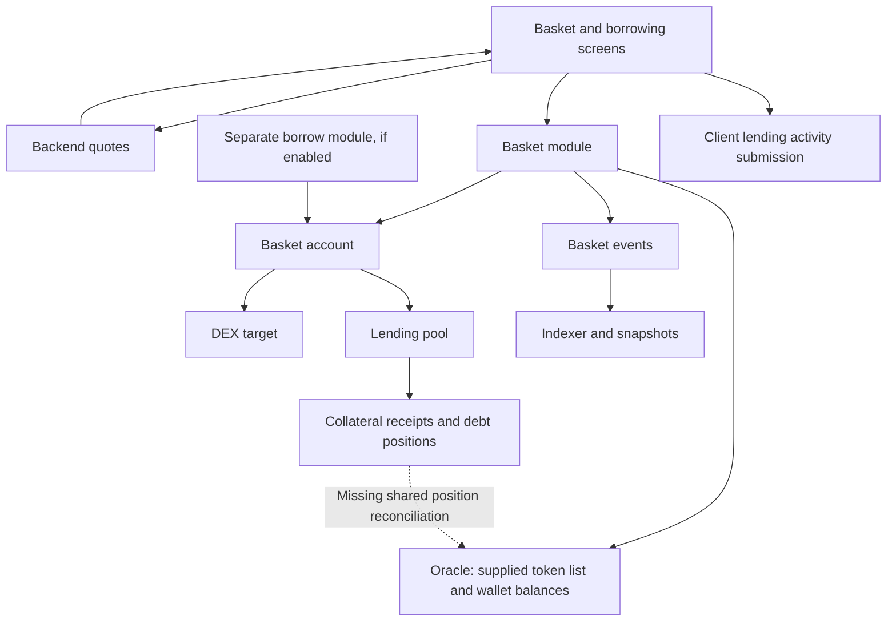

# Basket and lending lifecycle: gap review

Review date: 2026-09-09  
Baseline: current working tree on `main`, starting from commit `e3e1562`, including existing uncommitted changes.  
Purpose: identify where basket actions stop composing correctly once collateral, debt, swaps, and external state changes are introduced.

Implementation planning: [Subagent work packages, UI improvements, and borrowing-disabled launch assessment](/Users/jashmehta/Documents/Work/othelio/docs/reviews/basket-lending-work-packages.md).

## Read this first

**The central gap is the absence of a shared position model across basket trading, lending, valuation, and the UI.** Basket operations inspect directly held ERC-20 balances. Lending moves assets into external positions. Quotes, NAV, and UI state do not consistently reconcile those positions.

This document inventories the reviewed action surfaces and their interactions. It is not a claim that every possible vulnerability has been found. No mainnet deployment or live reserve configuration was verified. No new exploit or fork reproduction was run. Source-confirmed behavior is explicitly distinguished from runtime verification below.

The most urgent work is to establish reliable positions and executable quotes, then define debt-aware rebalance and exit behavior. An attractive health-factor display cannot compensate for incorrect underlying position reads.

### Evidence labels

| Label | Meaning |
| --- | --- |
| **C — Source-confirmed** | The current source directly establishes the behavior or missing check. Runtime consequences may still depend on the stated conditions. This does not mean an exploit was reproduced. |
| **U — Unconfirmed** | A plausible edge case requiring a targeted test, deployed configuration check, or additional tracing. Do not report it as an established production bug. |
| **D — Design decision** | The code permits behavior but the intended product contract is unresolved. Decide policy before prescribing a restriction. |
| **T — Existing test evidence** | An existing test was run successfully; evidence is limited to its assertions and mocks. |

Priority is remediation order, not a formal audit severity: **P1** before relying on real lending/rebalance flows; **P2** correctness and operational hardening; **P3** secondary behavior/documentation.

## 1. What users and contracts can do

| Surface | Entry points / integration | Current behavior |
| --- | --- | --- |
| Create | Factory `createBasket`, `createAndSeedBasket` | Deploys a custom single-owner account; optionally deposits and swaps. Imported-basket registration was removed during the production-hardening remediation. |
| Fund / “mint” | Basket module `fundWithSwaps`, `fundWithSwapsFromFactory` | Pulls input from the funder and optionally calls a target. No fungible basket-share issuance. |
| Spot rebalance | Basket module `rebalance`; UI `handleExecuteRebalance`; backend `quoteSwaps` | One external call plus caller-selected token balance deltas and NAV. |
| Withdraw | Basket module `withdrawWithSwaps`, `withdrawInKind` | Transfers directly held assets. Does not automatically settle lending positions. |
| Supply | Basket module `supplyToAave`; borrow module `supplyCollateral` | Approves a pool and calls Aave-shaped supply with the basket as beneficiary. |
| Borrow | `borrowFromAave` / `borrowToSafe`; `borrowAndSweep` / `borrowToWallet`; `borrowAndReinvest` | Debt belongs to the basket; proceeds stay in it, go to a recipient, or enter a swap. |
| Repay | `repayAave` / `repayDebt` | Approves and spends debt tokens already held by the basket. |
| Release collateral | `withdrawFromAave` / `withdrawCollateral` | Calls a pool, with configurable recipient. Pool checks govern actual withdrawability. |
| Generic execution | `executeTransaction`, `executeLending` | Owner-authorized arbitrary calls; lending wrapper adds a pool allowlist and optional approval. |
| Account administration | `enableModule`, `setOwner` | Adds permanent module permissions in the current interface; transfers account control. |
| Passive changes | Interest, prices, liquidation, direct transfers, pool governance | Can change the economic position without a basket module event. |

### Execution map



The factory-created account does not invoke `OthelioBasketGuard`. The guard is deployed by the script, but its existence is not evidence that it protects these account calls.

## 2. Position model and invariants to agree on

For a basket, at one block and consistent prices:

`gross assets = directly held assets + supplied assets / receipt-token claims`

`equity = gross assets − accrued debt`

`spendable assets ≠ gross assets`

Count a supplied position once: either value its receipt claim or use the lending adapter's underlying-equivalent balance, never both. Track each position by **chain, basket, protocol, pool/market, and asset**. A protocol name alone is insufficient.

| Operation | Expected economic invariant, ignoring fees and price movement |
| --- | --- |
| Fund with $X | Equity rises by the actual value received, not the requested transfer amount. |
| Supply $X | Wallet assets fall and supplied assets rise; equity stays unchanged. |
| Borrow $X into basket | Assets and debt both rise by $X; equity stays unchanged. |
| Borrow $X to wallet | Basket equity falls by $X; the owner receives $X externally. Track it as a distribution, not trading loss. |
| Repay $X from basket | Assets and debt both fall by actual repayment; equity stays unchanged. |
| Withdraw collateral into basket | Supplied assets fall and wallet assets rise; equity stays unchanged. |
| Withdraw assets to owner | Basket equity falls by value actually delivered; any remaining debt persists. |
| Rebalance | Holdings change; equity changes only through execution costs / price movement. Each affected lending market must remain valid at every checked intermediate step. |

Health must be calculated **per lending risk domain**. Collateral in another independent pool does not automatically secure this pool's debt. A portfolio-wide ratio can conceal a liquidatable position.

## 3. Action × starting-state matrix

“Needs orchestration” means the current wrapper is not a complete implementation of the user intent; it does not mean Aave permits an unsafe withdrawal.

| Starting state | Add funds | Rebalance | Repay | Withdraw / exit |
| --- | --- | --- | --- | --- |
| Wallet assets only, no debt | Basic funding path; verify real DEX route | Spot trade; current quote defects apply | No debt: reject or explicit no-op | Wallet transfer/swap |
| Partly supplied, no debt | New deposit stays liquid unless explicitly supplied | Must include both liquid and supplied allocation; redeem portion as needed | No debt | Redeem supplied part if full exit intended |
| Fully supplied, no debt | Possible, but NAV must include existing supply | Needs withdrawal → swap; cannot sell absent underlying | No debt | Pool liquidity / reserve rules may block full redemption |
| Debt proceeds still in basket | Possible; decide whether to deleverage | Trading cash does not change original collateral or debt | Use basket debt-token liquidity | Exit must reserve/source debt repayment |
| Debt proceeds sent to wallet | Funding can provide repayment liquidity | Collateral remains encumbered | Needs wallet → basket funding or another liquidity source | Cannot assume all collateral is withdrawable |
| Debt proceeds reinvested | More liquid assets, same debt until repayment | Decide whether replacement assets stay liquid or become collateral | Needs swap back to debt asset, with slippage and accrued interest | Sell/redeem/repay in a valid order |
| Multiple markets / debt assets | Attribute funds intentionally | Check every affected market, not blended health | Pin original market and debt token | Settle every intended liability |
| Near liquidation | May help only if supplied or used to repay | Reducing collateral may fail immediately | Must reflect fresh debt and execution state | Only currently withdrawable amount |
| Liquidated since last read | Refresh actual positions first | Stale quote must be invalidated | Debt and collateral may differ from UI | Reconcile remaining receipts and debt |
| RPC unavailable / tx pending | Show unknown/pending | Do not use fallback holdings as verified balances | Do not show debt cleared on submission | Do not mark exit complete before settlement |

## 4. Source-confirmed gap register

Each row identifies a concrete code observation. The final column is the acceptance test to add, not a claim that it has already passed.

### Trading, funding, and withdrawal

| ID | Priority | Finding and trigger | Evidence | Required verification / closure |
| --- | --- | --- | --- | --- |
| C01 | P1 | Rebalance reads wallet balances and performs one external call; no built-in redeem/repay/resupply sequence. Selling fully supplied underlying cannot be fulfilled by an ordinary spot router. | S1 `rebalance` | Supply → borrow → rebalance on real pool fork; either build a valid collateral plan or reject with a clear reason. Generic calldata alone is not a guaranteed collateral planner. |
| C02 | P1 | Quote builder does not compute current-to-target allocation deltas. UI omits input amount; backend defaults to 1,000 USDC. | S8 `quoteSwaps`; S9 `handleExecuteRebalance` | Rebalance baskets of different sizes with no idle USDC; quote must sell actual overweight assets. |
| C03 | P1 | Rebalance quote marks `boughtAssets.slice(0, 1)` as sold. When that first token increases, contract requires the opposite and reverts. | S8 quote return; S1 sold-delta check | Execute a quote with nonzero first output; confirm current `INVALID_SOLD_DELTA`, then ensure disjoint net sell/buy sets. |
| C04 | P1 | Backend replaces provider calldata with mock `swapMulti` encoding while retaining a selected router; one router address is also overwritten across independently quoted trades. | S8 `quoteSwaps` | Multi-asset, multi-provider integration against actual router ABIs. Validate target/calldata as one inseparable route and aggregate all legs. |
| C05 | P2 | No-swap funding emits post-deposit absolute balances as acquired amounts and skips minimum-output checks. | S1 `_fundWithSwaps` | Existing balance + deposit with empty calldata; assert actual deposit delta and explicit no-swap semantics. |
| C06 | P2 | Funding records pre-swap balances after pulling input. If the input asset is also listed as bought and the swap consumes it, the nonnegative bought-delta check can revert. | S1 `_fundWithSwaps` | USDC deposit with USDC retained as a basket constituent; separate net input accounting from swap-output accounting. |
| C07 | P1 | Withdrawal with swaps falls back to the entire output balance when output delta is zero, even if no swap ran. `soldAssets` is not used to establish what was sold. | S1 `withdrawWithSwaps` | Prefund output token, execute no-op/zero-output call, and check whether sweeping the preexisting balance was intended. Require explicit amount/sweep semantics. |
| C08 | P1 | Rebalance has no maximum sold amounts, target-weight enforcement, deadline, or independent route validation. It only checks declared bought minima and net deltas. | S1 `RebalanceParams`, `rebalance` | Excessive input spend with acceptable output; stale route; omitted token movement. Owner authorization limits the trust claim: this is protection from a bad owner-approved route, not demonstrated outsider theft. |
| C09 | P2 | `borrowAndReinvest` checks call success but has no output minimum or balance postcondition; empty target/data leaves borrowed assets liquid. | S1 and S2 `borrowAndReinvest` | Successful zero-output router and no-op reinvest; define and enforce expected receipt and destination. |

### Lending positions and product state

| ID | Priority | Finding and trigger | Evidence | Required verification / closure |
| --- | --- | --- | --- | --- |
| C10 | P1 | NAV sums caller-selected positive balances; no debt subtraction or automatic supplied-position discovery. Omitted tokens disappear; duplicate tokens are counted twice. | S1 NAV paths; S5 `calculateNAV` | Invariant sequence fund → supply → borrow → repay → withdraw; omitted/duplicate token arrays. Use canonical discovered positions and explicit gross/equity metrics. |
| C11 | P1 | Lending UI reads `userSupplied` and `userBorrowed`, methods provided by the local mock. Failed reads are silently skipped, producing missing supply or retained/default debt state. | S10 `checkLiveBalances`; S6 | Reload a real Aave position. Read receipt/debt tokens or protocol position APIs; failures must become unknown, never zero. Aave reference: R1. |
| C12 | P2 | Successful zero-debt reads are excluded by `if (debtUsd > 0)` and results merge into previous state. A position repaid externally can remain displayed as indebted. | S10 `checkLiveBalances` | Full repayment outside this UI followed by refresh; replace observed zero values and isolate state by basket/chain. |
| C13 | P1 | Borrow-to-wallet removes debt tokens from basket, while repay spends from the basket. The reviewed repayment handler does not transfer wallet funds in first. | S1 sweep/repay; S10 `handleRepayExecute` | Borrow to wallet → repay with empty basket. Implement an explicit funding step or communicate required basket liquidity. |
| C14 | P1 | All selected lending venues are executed through Aave-shaped methods in the main lending UI, despite backend adapters producing different calldata. Borrow module convenience methods also use Aave selectors. | S10 supply/borrow/repay/withdraw handlers; S2; S12 | Execute each advertised protocol with its correct adapter; do not infer compatibility from common action names. |
| C15 | P1 | Supplied balances are summed across pools, then assigned to a currently selected/recommended protocol. Repay/withdraw chooses from current venue quotes instead of an immutable position identity. | S10 `checkLiveBalances`, `suppliedNavByProtocol`, handlers | Supply in pool A, change recommendation to B, then withdraw/repay. Operations must target the original position. |
| C16 | P1 | Health display uses total supplied value, total UI debt, and fixed 80% threshold. Prices/quantities can fall back to static estimates; holdings conversion assumes 18 decimals. | S10 `holdingsWithBalances`, `healthFactorInfo`; S11 | Two pools with different risk parameters, a six-decimal asset, and failed RPC. Show per-market protocol health with timestamp/block. |
| C17 | P2 | An asset with any supplied amount is removed from `unsuppliedHoldings`, even when it also has a liquid balance. | S10 filters | Partially supply an asset, then add more of it; both liquid and supplied amounts must remain actionable. |
| C18 | P1 | UI mutates debt and sends activity after receiving a transaction hash, without waiting for a successful receipt in these handlers. | S10 borrow/repay handlers | Submit then revert/replace/drop transaction; show pending separately and reconcile only confirmed execution. |
| C19 | P2 | Main lending UI posts `/v1/baskets/lending-event`; reviewed controller exposes `/:address/lending-log`. Failures are swallowed. | S10 activity submissions; S14 | HTTP contract test for the actual route and payload, including `WITHDRAW_COLLATERAL` versus backend declared `WITHDRAW`. |
| C20 | P1 | `recordLendingEvent` trusts submitted amount/action/hash and writes synthetic block metadata without checking a receipt. Indexer ABI contains basket events but no lending events. | S8 `recordLendingEvent`; S15 | Failed/replayed/submitted-only transactions must not become confirmed financial activity. Index protocol events and periodically reconcile passive changes. This is a data-integrity finding, not a demonstrated unauthenticated endpoint exploit. |

### Contract boundaries, valuation, and mocks

| ID | Priority | Finding and trigger | Evidence | Required verification / closure |
| --- | --- | --- | --- | --- |
| C21 | P1 | Oracle defines `MAX_STALENESS` but never enforces it. Invalid/missing/reverting feeds fall back to $1 per token; unsupported assets also receive fallback value. | S5 | Old timestamp, zero/negative/reverting feed, unregistered 6-decimal asset. Explicit unknown/unpriceable state or revert for critical valuation. |
| C22 | P1 | Account only returns low-level call success and discards return data. ERC-20 `false` can therefore be treated as successful approve/transfer/sweep; generic protocols with error-code returns have the same integration hazard. | S3 `execTransactionFromModule`; S1/S2 transfer and lending calls | False-return token and protocol nonzero error-code mock; verify actual movement or decode protocol-specific results. Relevant Moonwell semantics: R3. |
| C23 | P2 | `setFactory` is first-caller-wins with no deployer authorization. A wrong first caller permanently selects a different factory. | S1 `setFactory`; S16 separate initialization | Deployment ordering/front-run test. Wrong factory can block seeding; exploitation beyond that requires a separate proof. Constructor binding or authenticated initialization. |
| C24 | P2 (remediated) | Anyone could `registerBasket` with arbitrary safe/owner values; factory membership was not proof of ownership or account implementation. | Historical S4 `registerBasket` | The entry point was removed. The factory now recognizes only accounts it creates. |
| C25 | P1 | Factory-created accounts do not call the guard. Generic basket execution can call any target, so the lending allowlist is not a universal account policy. | S3, S4, S1 `executeTransaction`, S7 | Attempt a call outside `executeLending`. Decide whether owner freedom is intended (D03) before adding policy enforcement. |
| C26 | P2 | `enableModule` has no corresponding disable method; the original immutable module remains authorized. | S3 | Enable an unwanted module and exercise recovery. Define migration/revocation before depending on module removal. |
| C27 | P1 | Aave mocks omit collateral constraints and realistic interest/liquidation behavior. Test pool withdraw does not burn its mock aTokens. | S6; S17 mock pool | Use real fork or a strict mock for risk tests; assert token conservation and receipt burning. Existing green tests are insufficient. |
| C28 | P1 | Local mock health-factor math returns an unscaled ratio (e.g. 200 for an intended 2.0) instead of 1e18 scale. Borrow availability can underflow when debt exceeds 80% of supplied value but is below supplied value. Only hardcoded USDC contributes collateral. | S6 `getUserAccountData` | $1,000/$400 must yield 2e18 HF; $1,000/$900 must not panic; non-USDC collateral must count correctly. |
| C29 | P1 | Mock DEX catches input-transfer failures and can mint outputs anyway. This hides missing input liquidity/allowance. | S18 `swap`, `swapMulti` | Zero allowance/zero input balance must fail the intended swap. Do not use this mock as settlement evidence. |
| C30 | P1 | Deployment script unconditionally replaces the Aave-address code with the mock on chain 31337. An Anvil fork run through this branch is not testing real Aave at that address. | S16 local-chain branch | Verify runtime bytecode before fork tests; isolate mock deployment from real-fork fixtures. |
| C31 | P2 | Withdrawal events are stored by the indexer but that branch does not insert/update a basket snapshot; funding/rebalance branches do. | S15 event match | Withdraw and inspect snapshot consumers; ensure position/NAV refresh is triggered and does not leave stale totals. |
| C32 | P1 | Morpho adapter uses placeholder zero collateral/oracle/IRM and queries zero market ID; it does not resolve a selected market. | S12 Morpho adapter | Resolve all five market parameters and matching market ID; distinguish loan supply from collateral supply. See R2. |
| C33 | P2 | Venue availability is inferred from rates, not transaction-specific eligibility; Compound/Moonwell rate queries do not validate the requested asset. | S12 adapters; S13 | Unsupported asset, exhausted cap, insufficient collateral, and zero-rate valid market. Separate market discovery, rate quote, and execution simulation. |

## 5. Unconfirmed edge cases: investigation backlog

These are intentionally **not** called confirmed bugs. Some may be safe protocol reverts; others may become serious when composed with confirmed gaps.

| ID | Priority | Scenario / question | Why unresolved | Test or evidence needed |
| --- | --- | --- | --- | --- |
| U01 | P1 | Are each basket's tokenized assets actually supported collateral in the intended live Aave reserve? | Local registry approval and mock supply prove nothing about real reserve configuration. | Pin chain/block; query reserve list, collateral eligibility, LTV/LT and caps; simulate supply/borrow. |
| U02 | P1 | Borrow → sell pledged asset → resupply a replacement. Does an intermediate withdrawal fail even if final health would be good? | No actual collateral-rebalance implementation or real-pool reproduction. | Fork with debt and reduced headroom; attempt each intermediate step. Aave checks withdrawals; see R4. |
| U03 | P1 | Repay-all after time passes leaves interest dust or exceeds basket liquidity. | Current UI uses an amount estimate; no time-advanced fork test. | Accrue interest, repay exact principal, then supported max-repay flow; assert live residual debt and actual payment. |
| U04 | P1 | Full basket exit with debt and insufficient liquid debt tokens. | No complete close-position workflow. | Borrow to wallet and reinvest variants; determine required external funds, swap path, partial repayment or flash liquidity. |
| U05 | P1 | Liquidation occurs between quote, signing, and execution. | No liquidation/event reconciliation test. | Liquidate on fork, refresh, simulate stale action, compare debt/receipts/UI afterward. |
| U06 | P1 | Pool pause/freeze, supply/borrow cap, isolation mode, eMode, or insufficient pool cash changes action eligibility. | Deployed reserve state not checked. | Table-driven tests per action and actual protocol configuration; expected safe rejection versus successful execution. |
| U07 | P1 | Wrong chain/pool address or reserve ABI version causes misreads/calls. | Constants exist but deployed code/version was not verified. | Address-code checks and ABI decode tests for every supported chain; reject unsupported chain instead of falling back. |
| U08 | P1 | Real DEX needs allowance/Permit2, different recipient, deadline, or several router calls. | Mock route is permissive; exact production route not executed. | Quote-to-execution test with existing allowance zero; confirm spender, recipient, output, and leftover approvals. |
| U09 | P1 | A fee-on-transfer/rebasing/nonstandard token breaks balance deltas or transfer assumptions. | Supported token behavior not audited. | Token fixtures plus token-specific compatibility list; exact input received and recipient output accounting. |
| U10 | P2 | Reentrant router/token can reenter an owner-authorized path through a contract owner. | No proven attacker path; ordinary router callers fail owner checks. | Explicit malicious-owner/router threat model and bounded PoC; do not label absence of a guard itself an exploit. |
| U11 | P1 | Replacement collateral has lower LT or is not collateral at all. | Product does not define which target assets must remain collateral. | Rebalance across differing reserve risk parameters; require per-market post-state constraints. |
| U12 | P2 | An old approval remains after partial/max repayment or a failed-return approval. | Approval-reset policy and supported token behavior not established. | Inspect allowance before/after partial actual repayment; test zero-first approval tokens. |
| U13 | P1 | Moonwell redeem uses receipt units where caller expects underlying units, or a nonzero return code is ignored. | Adapter passes raw amount to `redeem`; end-to-end amount contract and live execution unverified. | Define amount unit, test exchange rate not equal to one, decode success/error. See R3. |
| U14 | P2 | Reorg or indexer restart duplicates/misses accounting. | No replay/reorg reproduction. Indexer also has a large-backlog fast-forward branch. | Replay identical logs, revert a block, restart mid-batch, and scan a >50k-block backlog; reconcile canonical balances. |
| U15 | P2 | Owner transfer leaves old owner basket listings or permissions misleading. | Factory `_userBaskets` is creation/registration based; downstream reconciliation not fully traced. | Transfer owner and test both users' listings and transaction authorization. |
| U16 | P2 | Oversized/duplicate/zero-address token arrays or extreme decimals lead to gas failures, skipped checks, or arithmetic reverts. | Several source paths permit these values; practical caller routes not exhaustively exercised. | Fuzz input normalization and registry decimals; define bounded array size and unique canonical token sets. |
| U17 | P1 | Direct aToken transfers, external repayment, or direct token funding go unreflected. | Basket-event indexer does not cover all passive/direct changes; effect across every consumer unverified. | Change position outside module, reload all screens and compare same-block canonical state. |
| U18 | P2 | Switching basket/chain while async reads are outstanding applies old results to new state. | Reads and local maps need lifecycle testing. | Delay RPC, switch context, resolve old request; ensure results are scoped and stale writes discarded. |
| U19 | P2 | Price divergence between basket oracle and lending oracle makes a displayed safe position unsafe at the pool. | No paired feed comparison. | Compare sources/timestamps and show protocol HF separately from portfolio valuation. |
| U20 | P2 | Flash-loan collateral migration fails due to fee, callback authentication, liquidity, or intermediate constraints. | No such implementation exists in reviewed contracts. | If selected as design, specify callback trust, repayment funds, atomicity and fee/slippage bounds before implementation. |

## 6. Design decisions, not yet bugs

| ID | Decision | Suggested default for discussion |
| --- | --- | --- |
| D01 | Does “rebalance” target wallet holdings, total economic exposure, or only collateral? | Expose scope explicitly; include supplied exposure when presenting basket weights. |
| D02 | With debt outstanding, preserve debt amount, leverage ratio, or target health factor? | Require a declared debt policy and market-specific safety floor in the plan. |
| D03 | Is this an unrestricted owner account or a policy-constrained basket? | Document current owner freedom. If constrained, enforce policy on every account execution path, including enabled modules. |
| D04 | Does “withdraw” mean a selected liquid withdrawal or complete position exit? | Separate the actions. A complete exit must reconcile all debt and supplied claims. |
| D05 | Can a user hold unsupported/unpriced tokens? | Permit custody if desired, but report unpriced exposure explicitly; do not silently value at $1. |
| D06 | Are multiple protocols production scope now? | Enable each only after its position reader, action encoder, risk checks and fork suite pass. |
| D07 | Is “mint” intended eventually to issue shares? | Current design is account funding. If shares are added, a separate share-pricing/solvency review is required. |
| D08 | What does the risk buffer mean: percentage points of LTV or percent headroom? | Current helper subtracts percentage points and clamps to at least 5%; specify accepted range and terminology. |

## 7. Concrete scenarios to use in discussions and tests

### A. Supply → borrow → rebalance

Start with $1,000 of an eligible asset; supply all of it; borrow $400 USDC into the basket. Ignoring interest, gross assets are $1,400, debt $400, equity $1,000. A wallet-only list of the original underlying plus USDC reports $400 instead.

Selling the USDC into another asset changes wallet composition only. It does not replace the original Aave collateral. To change that collateral, a plan needs redeemable liquidity and a valid intermediate health factor. Aave may require repayment or additional collateral before withdrawal; see R4. A single atomic transaction does not defer every protocol check to its end.

### B. Borrow to wallet → repay

With $1,000 supplied and $400 sent to the wallet, basket equity is $600 and basket USDC may be zero. Calling the current repayment function does not debit the wallet. A successful path needs an explicit funding source and enough funds for accrued debt. No wallet funding should be silently assumed.

### C. Partial supply → add funds → refresh

Supply half an asset, then add more of it. Both supplied and liquid balances exist. Current UI grouping treats any supplied asset as supplied-only. On real Aave, mock-only reads can hide the supplied side altogether. This scenario catches both state discovery and action-availability defects.

### D. Choose a new “best” venue after borrowing

A loan in pool A remains in pool A when pool B becomes cheaper. Recommendation changes are not position migration. Repay and withdraw must use stored/discovered position identity. Actual migration requires explicit settlement and reopening, with costs and health constraints.

## 8. Verification plan and release gates

### Existing evidence

Executed during the initial review, against the same working-tree source:

```sh
cd contracts
/Users/jashmehta/.foundry/bin/forge test --match-contract 'Othelio(AaveIntegration|BorrowModule|BasketModule)Test' --offline
```

**T01: 17 passed, 0 failed, 0 skipped**: basket module 9; Aave integration 4; borrow module 4. This is a passing baseline only. No new scenario tests were added for this document. In particular, `testRepayAndWithdraw` only repays; it does not execute a withdrawal. The integration “health factor” assertion uses hardcoded arithmetic, not protocol health.

### Proposed test packs

| Pack | Cases | Evidence required |
| --- | --- | --- |
| V1 — Accounting | C05–C07, C10, C21–C22; every invariant in section 2 | Balance, debt, equity, event and recipient deltas; unsupported valuation is explicit. |
| V2 — Real lending lifecycle | C01, C11–C16, C27–C30; U01–U07, U11 | Pinned real-pool fork with unchanged pool bytecode; accrued interest and near-threshold cases. |
| V3 — Real trading | C02–C04, C08–C09, C29; U08–U09 | Execute actual quote calldata with actual spender approvals; fail closed on route/amount mismatch. |
| V4 — Position/UI consistency | C11–C20, C31; U14–U18 | Reload, external action, zero debt, failed tx, replacement, chain switch, and canonical refresh checks. |
| V5 — Authority and recovery | C23–C26; U10, U12, U15 | Owner/nonowner tests, initializer ordering, module recovery, explicit trust-policy assertions. |
| V6 — Protocol adapters | C14–C15, C32–C33; U06–U07, U13 | Per-chain/per-market supported action table; correct calldata, units, return handling and position reader. |

### Suggested order

1. **Make state trustworthy:** canonical position readers, debt-inclusive valuation, real reserve identities, no fallback-as-fact UI, receipt-confirmed activity.
2. **Make spot operations trustworthy:** actual current-to-target quotes, valid multi-leg execution, approval handling, input/output bounds and funding/withdrawal deltas.
3. **Define and implement debt-aware actions:** explicit repay funding, collateral rebalance and complete-exit plans; per-market intermediate and final risk checks.
4. **Prove realism:** isolate mocks from fork fixtures, then run the lifecycle and passive-change packs. Add per-protocol support only when proven.

A gap closes only when its expected behavior is agreed, the implementation exists, and a named regression test or deployment evidence is linked. Keep a source-confirmed gap open until then.

## 9. Source map

Links open the reviewed workspace files; symbols are more stable than line numbers as the working tree changes.

| Ref | File and reviewed symbols |
| --- | --- |
| S1 | [contracts/src/safe/OthelioBasketModule.sol](/Users/jashmehta/Documents/Work/othelio/contracts/src/safe/OthelioBasketModule.sol): all public actions, `_fundWithSwaps`, approvals and NAV loops |
| S2 | [contracts/src/safe/OthelioBorrowModule.sol](/Users/jashmehta/Documents/Work/othelio/contracts/src/safe/OthelioBorrowModule.sol): all lending wrappers and `executeLending` |
| S3 | [contracts/src/safe/OthelioBasketAccount.sol](/Users/jashmehta/Documents/Work/othelio/contracts/src/safe/OthelioBasketAccount.sol): authorization, module enabling, execution, owner transfer |
| S4 | [contracts/src/factory/OthelioSafeFactory.sol](/Users/jashmehta/Documents/Work/othelio/contracts/src/factory/OthelioSafeFactory.sol): creation, seeding, registration and owner listing |
| S5 | [contracts/src/oracle/BasketOracle.sol](/Users/jashmehta/Documents/Work/othelio/contracts/src/oracle/BasketOracle.sol): `calculateNAV`, `MAX_STALENESS` |
| S6 | [contracts/src/mock/MockAavePool.sol](/Users/jashmehta/Documents/Work/othelio/contracts/src/mock/MockAavePool.sol): supply/borrow/repay/withdraw, account data |
| S7 | [contracts/src/safe/OthelioBasketGuard.sol](/Users/jashmehta/Documents/Work/othelio/contracts/src/safe/OthelioBasketGuard.sol): transaction and post-execution checks |
| S8 | [backend/src/baskets/baskets.service.ts](/Users/jashmehta/Documents/Work/othelio/backend/src/baskets/baskets.service.ts): `quoteSwaps`, `recordLendingEvent` |
| S9 | [fe/src/features/baskets/BasketDrawer.tsx](/Users/jashmehta/Documents/Work/othelio/fe/src/features/baskets/BasketDrawer.tsx): `handleExecuteRebalance` |
| S10 | [fe/src/features/borrow/BasketBorrowManagement.tsx](/Users/jashmehta/Documents/Work/othelio/fe/src/features/borrow/BasketBorrowManagement.tsx): position reads, computed values, action handlers |
| S11 | [fe/src/lib/lending.ts](/Users/jashmehta/Documents/Work/othelio/fe/src/lib/lending.ts): risk helpers, venue parsing and hardcoded risk thresholds |
| S12 | [backend/src/lending/adapters/](/Users/jashmehta/Documents/Work/othelio/backend/src/lending/adapters): Aave, Compound, Moonwell and Morpho adapters |
| S13 | [backend/src/lending/lending-manager.service.ts](/Users/jashmehta/Documents/Work/othelio/backend/src/lending/lending-manager.service.ts): quote ranking, portfolio summary |
| S14 | [backend/src/baskets/baskets.controller.ts](/Users/jashmehta/Documents/Work/othelio/backend/src/baskets/baskets.controller.ts): quote and lending-log routes |
| S15 | [indexer/src/main.rs](/Users/jashmehta/Documents/Work/othelio/indexer/src/main.rs): event ABI, block scanning, event/snapshot writes |
| S16 | [contracts/script/DeployOthelio.s.sol](/Users/jashmehta/Documents/Work/othelio/contracts/script/DeployOthelio.s.sol): deployment, mock etching and allowlist configuration |
| S17 | [contracts/test/OthelioAaveIntegration.t.sol](/Users/jashmehta/Documents/Work/othelio/contracts/test/OthelioAaveIntegration.t.sol), `OthelioBorrowModule.t.sol`, `OthelioBasketModule.t.sol`: baseline tests and mock pool |
| S18 | [contracts/src/dex/MockDEXRouter.sol](/Users/jashmehta/Documents/Work/othelio/contracts/src/dex/MockDEXRouter.sol): permissive input/output handling |

### External protocol references

- R1: [Aave V3 Pool source](https://github.com/aave/aave-v3-core/blob/master/contracts/protocol/pool/Pool.sol): reference interface and position/action entry points. The deployed pool version still requires verification.
- R2: [Morpho contract documentation](https://docs.morpho.org/developers/contracts/morpho/): market identity is derived from five market parameters; supply positions and collateral positions require distinct handling.
- R3: [Moonwell contract interactions](https://docs.moonwell.fi/moonwell/developers/protocol/mtokens/contract-interactions.md): receipt-token versus underlying redemption and protocol return semantics.
- R4: [Aave withdrawal guidance](https://aave.com/help/supplying/withdraw-tokens): collateral backing debt may require repayment/additional collateral before withdrawal; pool liquidity also constrains withdrawal.

## 10. Explicit coverage limits

Reviewed: basket/lending contracts, custom account/factory/guard, oracle, mocks, relevant tests, main rebalance/lending UI flows, quote adapters and lending logging/indexer surfaces.

Not established: deployed bytecode/configuration, live asset eligibility, exact production router compatibility, independent protocol audits, exhaustive malicious calldata/reentrancy analysis, complete backend authentication exposure, every UI variant, or every indexer recovery path. Those need dedicated verification; absence from this register does not establish safety.

This artifact changes no contracts or application behavior and does not authorize deployment.
