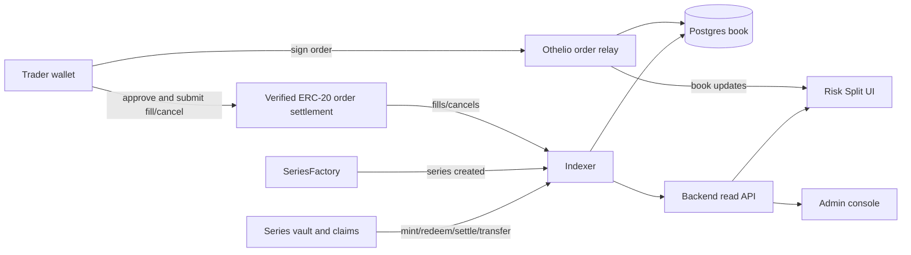

# Risk Split live markets and operator console

**Planning design · 2 November 2026**

## Intent and launch boundary

An operator using the current deployer wallet can launch a Risk Split series for one verified token on Base. A user can discover that real market, mint a Protected/Upside pair, see two live USDC order books, place and cancel limit orders, partially or fully fill an opposing order, and redeem after an objectively fixed expiry. The operator can inspect market state and basic Othelio activity through a small separate admin frontend. The first live launch uses one token and small transaction sizes, but token addresses and decimals are configuration/data, never MSFTc constants.

This is separate from baskets. The admin overview may count basket activity and manage basket asset onboarding; Risk Split custody and payoff do not depend on baskets.

## Current repository facts

- `SeriesFactory.createSeries` is permissionless and has no owner or creation flag. `RiskSplitSeries` and two `ClaimToken`s are deployed in one call.
- The vault already uses `SafeERC20` and `ReentrancyGuard`, checks exact incoming balance delta, and mirrors underlying claim decimals. Its `initializeTokens` has no caller restriction, direct deployment is possible, and zero-price settlement gives both sides zero underlying units.
- `SettlementAdapter` uses `latestRoundData()` when `settleSeries` is called after expiry. That is a call-time price, not necessarily the expiry fixing. Price/feed decimal compatibility is not enforced by the factory.
- The Risk Split backend reads `risk_split_series` and positions from Postgres. The migrations and an indexer *plan* exist, but `indexer/src/` has no Risk Split event ingestion. The UI therefore has no reliable deployed-market pipeline yet.
- The market page has disabled book controls. No order relay, matching service, order API, live depth, or trading settlement integration exists.
- Basket asset support spans `OthelioAssetRegistry`, `OthelioAerodromeRouteRegistry`, the backend catalog, and verified oracle/route data. Existing registry owner addresses may differ.

## Decisions for this plan

- Add `publicCreationEnabled`, initially `false`. Only `owner()` (the deployer wallet for this release) can create series or change the flag. Use two-step ownership transfer so a Safe can own it later. Public creation can be enabled only by an owner transaction. Existing deployments cannot be mutated in place; deploy a new factory if one exists.
- Use a separate admin frontend deployment from the same monorepo, sharing types, wallet infrastructure and app styling. Backend admin endpoints use wallet challenge/signature sessions and recheck onchain authority. The browser never holds an operator private key; transactions are signed by the connected deployer wallet.
- Admin creation is an explicit review-and-sign flow. No scheduler or unattended key launches series. A “round” means one immutable series with an expiry, not a mutable round inside a reusable vault.
- Two order books per series: `Protected/USDC` and `Upside/USDC`, with visible bids, asks, depth, fills and owner orders. The first implementation should use an existing verified ERC-20 limit-order settlement primitive, with Othelio owning the offchain book, relay and matching logic. The preferred spike is direct 0x v4 limit-order settlement on Base; 0x Swap API alone does not supply Othelio's visible resting book. Do not integrate Clober by assumption. If the spike fails the acceptance tests below, select another reviewed primitive and revise the venue design before writing a bespoke settlement contract.
- Fixing uses the **last valid, sufficiently fresh observation at or before expiry** from the nominated feed. A later settlement call cannot substitute a post-expiry price. The contract must verify the chosen round and prove that no later eligible round exists before expiry, including across feed phase changes; if this cannot be proven with the launch feed, pause the design and select a verifiable fixing method. Missing/stale observations halt settlement under a documented recovery rule, never silently switch to the next session's price.
- Only the deployer owner creates series in this release. The admin preview checks the *specific feed's* publication hours and calendar in `America/New_York`, including daylight saving time, holidays, early closes and a feed-cadence buffer from session boundaries. The factory checks an owner-approved exact expiry timestamp for that underlying, so a direct `createSeries` call cannot bypass the reviewed schedule. Trading may remain available after hours and on weekends before expiry; the first release does not offer weekend/holiday expiries.
- Quote prices are USDC per claim. Orders are signed EIP-712 messages, stored offchain and settled atomically onchain. The relay may hide an order instantly, but the UI must distinguish that from an onchain cancellation that makes it unfillable everywhere. Restrict accepted order expiry to no later than series expiry for the launch.
- No claim that software is bug-free. Production release requires independent contract security review, resolved high/critical findings, simulations and live small-size proofs. Contract owners have no withdrawal path for collateral.

## Operator experience

The admin entry shows chain, connected wallet, the onchain owner of each governed contract, and indexer freshness. It has four sections:

1. **Overview:** distinct active wallet addresses with a stated time window, basket count, supported assets, open/expired/settled series, mint/redemption totals, book health, failed settlement and indexing alerts. Counts are sourced from indexed events/database and show an “as of block” timestamp; do not call wallets “users.”
2. **Assets:** candidate identity/address, B20 factory status, decimals, supply, nominated price feed and freshness, executable route tests, registry and route approval state, backend `tradeable` state. Prepare and preview owner transactions for registries. “Visible but not tradeable” is supported. A Risk Split market can use only an explicitly supported underlying and compatible settlement feed.
3. **Markets:** drafts and deployed series, underlying, profile reference, floor, cap, expiry in UTC, feed/round, claim addresses, collateral, open interest, order books, status and links. Create preview checks price scales, payoff examples, duplicate terms, expiry timing, oracle readiness and exact target factory; then the deployer signs. Track transaction pending/confirmed/indexed as distinct states.
4. **Operations:** expiry queue, fixing candidate/round, settlement transaction, settlement receipt, unresolved incidents and read-only audit trail. Permissionless settlement may be triggered from here, but it must use the expiry fixing rule. Normal claim redemption remains available if operator services are down.

Admin web authentication protects drafts, operational data and write APIs. The onchain owner checks protect contract writes. UI button visibility alone is not authorization. No generic server-side `call(address,bytes)` endpoint: every allowed action has a typed handler, exact target/chain, validation, simulation and logged transaction hash.

## Trading system and state

The relay validates chain ID, venue/domain, maker signature, approved pair, claim membership in a factory series, price/size units, nonce/salt uniqueness, expiry, balances and allowances before accepting a quote. A matching worker orders by price then arrival time, proposes executable opposing orders, and tracks submission/mined/reverted states. The onchain settlement primitive is authoritative for remaining fill quantity and cancellation. Book quantities and best bids/asks are derived from valid unfilled orders and refreshed after fills, cancels, balance/allowance changes, reorgs, and reconnect. A failed match never becomes a reported trade. WebSocket/SSE book updates are versioned and recover by snapshot on sequence gap. UI shows when quotes are stale and never substitutes oracle marks for bids/asks.

The venue spike must prove Base deployment, token compatibility (including B20 semantics), EIP-712 signing, two-decimal-format pairs, fill, partial fill, cancellation, replay prevention, recovery after a reverted fill, fees/gas, and whether two *resting* opposing orders can be atomically crossed. If the primitive only supports a taker transaction against a resting maker, the MVP interaction is explicitly taker-driven: an incoming marketable order gets a wallet-confirmed fill transaction, and the remaining amount may rest as a new signed order. No invisible custodial matcher is implied.

## Contract and oracle invariants

- Only the factory owner creates while public creation is disabled; all other callers revert. Flag changes and ownership transfers emit events. Market terms are immutable and duplicate term keys are rejected or deliberately versioned.
- Each series accepts only an approved underlying and a feed whose token identity and decimal scale have been verified. Creation records source, reference round/price, normalized price and formula version in a verifiable event or immutable state. Profile labels use that record, not current spot.
- Only the factory can initialize a vault's claim addresses, exactly once; each claim's vault is that series, tokens differ, and all contracts are validated. Do not require ordinary bytecode for Base B20 precompile-backed assets.
- For every state, vault collateral covers outstanding joint claims. Before settlement, equal claim supply is backed by equal raw underlying. After settlement, all redemptions combined cannot exceed held collateral; no rounding scheme permanently strands material funds or lets one side overclaim. Define zero-price allocation so the raw underlying remains claimable.
- Mint, combine, settle and redeem obey checks/effects/interactions, strict token balance deltas and reentrancy protection. No admin withdraw, arbitrary external call, upgrade, or raw token recovery of the backing asset. Emergency pause, if included, affects new exposure only; pair recovery and matured claim redemption remain usable.
- Settlement price is tied to one permitted feed, chosen round and expiry, with the chosen round stored and emitted. It cannot be changed by delaying the settle transaction. Invalid, stale, incomplete, negative and wrong-scale readings revert. If no sufficiently fresh fixing exists by expiry, settlement is halted and recovery is a separately specified, reviewable governance procedure, not a silent post-expiry fallback.

## Launch acceptance

On a pinned Base fork, then Base test environment if the chosen token/venue is available there, then Base mainnet with one verified token and small amounts:

1. Unauthorized wallet cannot create a series; connected deployer creates one with verified floor/cap/reference/expiry and sees the confirmed series in admin and public market list after indexer catch-up.
2. A trader mints a pair; two wallets post visible bids/asks on both claim books. One order is partially filled, one fully filled, and another cancelled. Wallet balances, order remaining amounts, fills, fees and book depth agree with onchain receipts. A third wallet cannot replay or steal a signed order.
3. Expiry closes new mint and launch orders. The specified oracle round fixes settlement even if execution is delayed. Both claims redeem to underlying within the mathematically stated rounding bound; pair redemption and recovery remain possible as specified.
4. Admin overview and asset state reconcile with indexed chain state; stale indexer or book shows an explicit unavailable state. A service restart/reorg rebuilds correct series, positions and order state.
5. Static analysis, fuzz and invariant suites, fork tests, independent review, and signed deployment/runbook are complete. No unresolved critical/high findings; medium findings have written disposition before any meaningful mainnet exposure.

## Deferred

Safe ownership, public series creation, automatic round scheduling, multiple launch tokens, trading fees beyond venue cost, market making/liquidity guarantees, baskets as Risk Split underlyings, yield on collateral, perps, and guaranteed first-day liquidity. The book can be empty; an order book does not create counterparties.

## Evidence for venue choice

0x documents [ERC-20 limit orders and partial fill/cancel methods](https://github.com/0xProject/protocol/blob/development/docs/basics/orders.rst) and [exchange functions](https://github.com/0xProject/protocol/blob/development/docs/basics/functions.rst). Its [Swap API](https://docs.0x.org/evm/0x-swap-api/introduction) aggregates executable swaps, so it should not be mistaken for a hosted Othelio order book. Current Base support and deployed addresses must be verified during the spike. OpenZeppelin documents [ownership and role management](https://docs.openzeppelin.com/contracts/5.x/access-control) and [SafeERC20](https://docs.openzeppelin.com/contracts/5.x/api/token/erc20).
